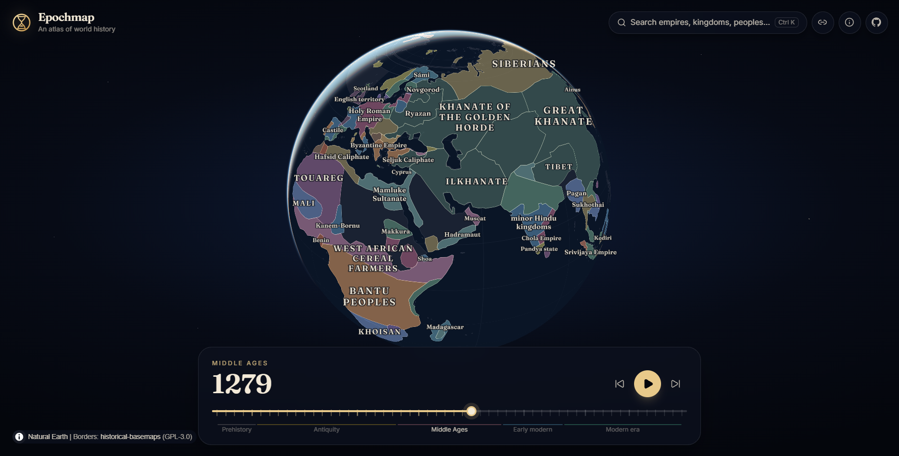
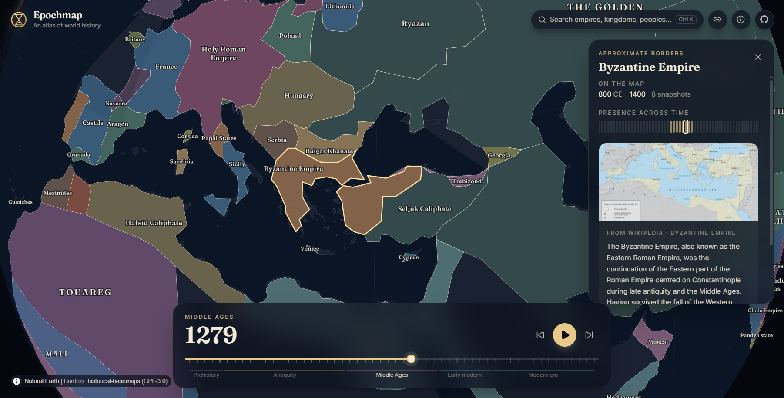

<p align="center">
  
</p>

<h1 align="center">Epochmap</h1>

<p align="center">
  <b>An interactive atlas of world history.</b><br />
  Drag through 125,000 years and watch empires, kingdoms and peoples rise and fall on a 3D globe.
</p>

<p align="center">
  <a href="https://berkanatik.github.io/epochmap/"><b>Open the live atlas →</b></a>
</p>

<p align="center">
  <a href="https://github.com/BerkanAtik/epochmap/actions/workflows/ci.yml"></a>
  <a href="LICENSE"></a>
  <a href="README.tr.md"></a>
</p>



## Features

- **A 3D globe** with a soft atmosphere that flattens into a map as you zoom in.
- **54 moments in history**, from 123,000 BCE to 2010. Borders cross-fade between periods instead of blinking.
- **Play** history like a time-lapse, or step through it with the arrow keys.
- **Click any region** to see its Wikipedia summary (in your language when a translation exists), when it appears on the map, and which power it answered to.
- **Search** more than 3,000 empires, kingdoms and peoples with <kbd>Ctrl</kbd> <kbd>K</kbd> / <kbd>⌘</kbd> <kbd>K</kbd> and fly straight to them.
- **Shareable links**: the URL always holds the year, the selected polity and the camera position.
- Colonies and vassals share their ruler's colour, drawn lighter, so empires read as one shape.
- English and Turkish interface, keyboard shortcuts and reduced-motion support.
- A static site: no backend, no API keys, no tracking.



## Keyboard shortcuts

| Key                                                                     | Action                 |
| ----------------------------------------------------------------------- | ---------------------- |
| <kbd>←</kbd> <kbd>→</kbd>                                               | Previous / next period |
| <kbd>Space</kbd>                                                        | Play / pause           |
| <kbd>Ctrl</kbd> <kbd>K</kbd>, <kbd>⌘</kbd> <kbd>K</kbd> or <kbd>/</kbd> | Search                 |
| <kbd>Esc</kbd>                                                          | Close the info panel   |

## How it works

**Data pipeline** ([`scripts/build-data.ts`](scripts/build-data.ts)). The border snapshots come from [historical-basemaps](https://github.com/aourednik/historical-basemaps), pinned to a commit so the output is reproducible. Each snapshot goes through [mapshaper](https://github.com/mbloch/mapshaper):

1. drop unnamed areas (the land layer shows those),
2. simplify the shapes topologically, so neighbouring borders stay in sync,
3. dissolve into one feature per polity, so hovering highlights the whole polity,
4. compute each polity's area and a label point well inside its shape.

The result is about 6 MB of GeoJSON split per period, plus a search index of every polity and the periods it appears in.

**Rendering** ([`src/components/GlobeMap.tsx`](src/components/GlobeMap.tsx)). MapLibre GL JS 6 draws the globe. There are two identical layer stacks. The next period is loaded into the hidden stack, and then the two cross-fade through paint-opacity transitions. Once the fade is over, the hidden stack is emptied so it costs nothing to render.

**Labels without a glyph server.** When a style has no `glyphs` URL, MapLibre draws text with the page's own fonts. It reads the font weight from the family name, so the variable Fraunces font is registered under a name ending in "Semibold" ([`src/lib/fonts.ts`](src/lib/fonts.ts)).

**Colours** come from a hash of the ruling polity's name. A polity keeps its colour through time, and colonies share their ruler's hue.

**Wikipedia summaries** go through the REST summary endpoint, fall back to search, and follow language links to the interface language. The requests are cached promises that React 19's `use()` reads inside a Suspense boundary.

**Loading.** Each period is fetched once and cached, and its neighbours are prefetched, so stepping and playback feel instant. Playback only advances after the current period has loaded.

## Tech stack

React 19 with the React Compiler · TypeScript 7 · Vite 8 (Rolldown) · Tailwind CSS 4 · MapLibre GL JS 6 · Motion · Biome · Vitest · GitHub Actions and GitHub Pages

## Running locally

You need Node.js 22.12 or newer.

```bash
git clone https://github.com/BerkanAtik/epochmap.git
cd epochmap
npm install
npm run dev
```

| Script          | What it does                                            |
| --------------- | ------------------------------------------------------- |
| `npm run dev`   | Start the dev server                                    |
| `npm run build` | Type-check and build the static site into `dist/`       |
| `npm test`      | Run the unit tests                                      |
| `npm run check` | Lint and format check (Biome)                           |
| `npm run data`  | Rebuild the map data in `public/data/` from the sources |

## Data and accuracy

The borders are approximate and simplified for a world-scale map. Historical boundaries were often fluid, contested or simply unknown, and many regions are labelled by culture rather than by state. Corrections to the borders are best made upstream in [historical-basemaps](https://github.com/aourednik/historical-basemaps), where they help every project that uses the data.

| Data               | Source                                                                                                        | License       |
| ------------------ | ------------------------------------------------------------------------------------------------------------- | ------------- |
| Historical borders | [historical-basemaps](https://github.com/aourednik/historical-basemaps) by André Ourednik and contributors    | GPL-3.0       |
| Land               | [Natural Earth](https://www.naturalearthdata.com/) via [world-atlas](https://github.com/topojson/world-atlas) | Public domain |
| Summaries          | [Wikipedia](https://www.wikipedia.org/), fetched live                                                         | CC BY-SA      |

## Roadmap

- Battles, treaties and foundings from Wikidata, shown on the globe at their date
- Smoother morphing between periods
- More interface languages
- Vector tiles for sharper borders when zoomed in

## Contributing

Issues and pull requests are welcome. Please run `npm run check`, `npm run typecheck` and `npm test` before opening a pull request.

## License

[GPL-3.0-or-later](LICENSE), because the border data is licensed under GPL-3.0.
