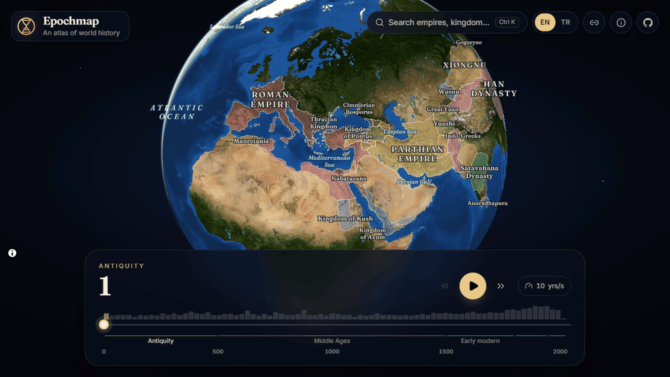
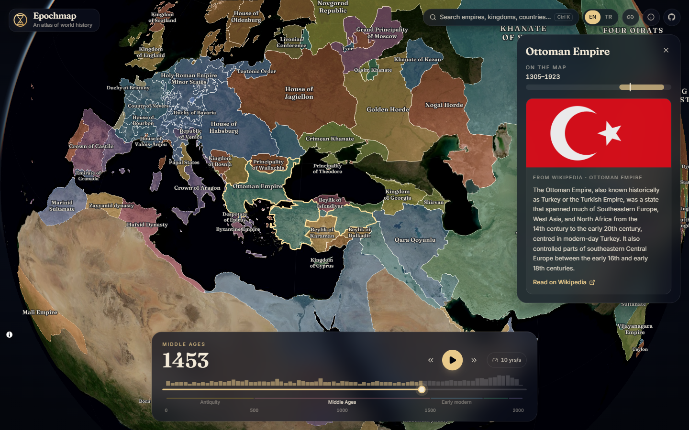

<p align="center">
  
</p>

<h1 align="center">Epochmap</h1>

<p align="center">
  <b>Etkileşimli bir dünya tarihi atlası.</b><br />
  0 yılından 2026'ya kadar her yılın siyasi dünya haritası, 3B bir küre üzerinde.
</p>

<p align="center">
  <a href="https://berkanatik.github.io/epochmap/?lang=tr"><b>Atlası aç →</b></a>
</p>

<p align="center">
  <a href="README.md">English</a>
</p>



## Özellikler

- **0'dan 2026'ya her yıl.** Zaman çizelgesini sürükleyin, bir yıl yazın ya da doğrudan bir sonraki sınır değişikliğine atlayın.
- **Tarihi oynatın.** Saniyede 10, 25 veya 50 yıl hızla imparatorlukların büyüyüp bölünmesini ve yok olmasını izleyin.
- **Akademik kaynaklı sınırlar.** Üç akademik ve açık veri seti kullanılıyor; bunlar birbiriyle karşılaştırılıp elle düzeltildi (bkz. [Ne kadar doğru?](#ne-kadar-doğru)).
- **Gerçek bir küre.** Siyasi haritanın altında NASA'nın Blue Marble uydu görüntüsü var ve kıyılar bu görüntüyle örtüşüyor.
- **Mavi okyanuslar, denizler ve göller.** Sığ kıta sahanlıklarından lacivert derin denizlere kadar; adları basılı atlaslardaki gibi italik yazılıyor.
- **Doğru oturan renkler.** Komşu ülkeler hiçbir zaman aynı renkte değil (4.600 komşu çiftinde sıfır çakışma). Bir ülke yüzyıllar boyunca rengini koruyor, sömürgeler de bağlı oldukları imparatorluğun renginde.
- **Tartışmalı bölgeler.** Kırım, Keşmir, Batı Sahra ve Kuzey Kıbrıs gibi bölgeler taralı gösteriliyor. Kimin yönettiği ve kimin hak iddia ettiği tarafsız bir notla açıklanıyor.
- **Her şeye tıklayın.** Wikipedia özeti, haritada var olduğu yıllar ve bağlı olduğu imparatorluk açılır.
- **Arama.** 1.380 devlet arasında Türkçe ya da İngilizce olarak <kbd>Ctrl</kbd> <kbd>K</kbd> / <kbd>⌘</kbd> <kbd>K</kbd> ile arayın.
- **Türkçe ve İngilizce arayüz.** İstediğiniz an değiştirebilirsiniz; haritadaki adlar da değişir.
- **Paylaşılabilir bağlantılar.** Yıl, seçim, dil ve kamera konumu bağlantıda saklanır.
- **Telefonda, tablette ve bilgisayarda çalışır.** Dokunmaya uygun boyutta düğmeler, dikey ve yatay ekran için ayrı düzenler var.
- **Tamamen statik site:** sunucu yok, API anahtarı yok, takip yok.



## Klavye kısayolları

| Tuş                                                                       | İşlev                              |
| ------------------------------------------------------------------------- | ---------------------------------- |
| <kbd>←</kbd> <kbd>→</kbd>                                                 | Bir yıl geri / ileri               |
| <kbd>Shift</kbd> + <kbd>←</kbd> <kbd>→</kbd>                              | On yıl geri / ileri                |
| <kbd>PgUp</kbd> <kbd>PgDn</kbd>                                           | Önceki / sonraki sınır değişikliği |
| <kbd>Boşluk</kbd>                                                         | Oynat / duraklat                   |
| <kbd>Ctrl</kbd> <kbd>K</kbd>, <kbd>⌘</kbd> <kbd>K</kbd> veya <kbd>/</kbd> | Ara                                |
| <kbd>Esc</kbd>                                                            | Bilgi panelini kapat               |

## Ne kadar doğru?

Hiçbir veri seti 2.000 yılı tek başına iyi kapsamıyor. Bu yüzden her dönem için o döneme ait en iyi açık kaynak kullanılıyor:

| Yıllar    | Sınırlar                                                                                                                               | Neden                                                                                                    |
| --------- | -------------------------------------------------------------------------------------------------------------------------------------- | -------------------------------------------------------------------------------------------------------- |
| 0–1885    | [Cliopatria](https://github.com/Seshat-Global-History-Databank/cliopatria) (Seshat Küresel Tarih Veri Bankası, _Scientific Data_ 2025) | Hakem denetiminden geçmiş; yaklaşık 1.600 devletin yıl yıl şekilleri.                                    |
| 1886–2013 | [CShapes 2.0](https://icr.ethz.ch/data/cshapes/) (ETH Zürih)                                                                           | Siyaset biliminde standart: devletlerin _ve_ sömürgelerin hukuken tanınan sınırları, gün hassasiyetinde. |
| 2014–2026 | [Natural Earth](https://www.naturalearthdata.com/) 1:10m                                                                               | Sahadaki durumu gösteren ayrıntılı günümüz sınırları.                                                    |

Veri hazırlama betiği bunların üzerine şunları yapıyor:

- **Her yılı doğru adlandırıyor.** 1886–2013 arasında ad, aynı yerdeki Cliopatria devletinden geliyor. Böylece harita 1923'e kadar Osmanlı İmparatorluğu'nu, 1924'ten itibaren Türkiye Cumhuriyeti'ni gösteriyor. Sömürgeler de imparatorluklarına bağlanıyor.
- **Devletleri sömürgelerden ayırıyor.** Bunun için Gleditsch ve Ward'ın bağımsız devletler listesini kullanıyor; böylece bağımsız bir ülke hiçbir zaman başka bir ülkenin nüfuz alanının parçası olarak çizilmiyor.
- **Kaynaklardaki bilinen hataları düzeltiyor.** Örneğin Cliopatria İstanbul'u 1467'ye kadar Bizans'ta, Cezayir'i 2023'e kadar Fransa'da tutuyordu. Roma İmparatorluğu'nu da Bizans'ın Wikidata kimliğiyle işaretlemişti. Tüm düzeltmeler gerekçeleriyle [`scripts/sources.ts`](scripts/sources.ts) dosyasında. `npm run data -- report` komutu bu hataları bulan kontrolleri yazdırıyor.

Sınırlar dünya ölçeğindeki bir harita için yine de sadeleştirilmiş durumda; tarihî sınırlar da çoğu zaman değişken ya da tartışmalıydı. Bir hata görürseniz lütfen [issue açın](https://github.com/BerkanAtik/epochmap/issues).

## Nasıl çalışıyor

**Veri hattı** ([`scripts/build-data.ts`](scripts/build-data.ts)). Her kaynak sabitlenmiş bir sürümde indiriliyor. Üç dönem, her biri bir yıldan başka bir yıla kadar geçerli olan tek bir şekil listesinde birleştiriliyor. Ardından [mapshaper](https://github.com/mbloch/mapshaper) şu adımları uyguluyor:

1. Ortak sınırları birebir aynı tutarak şekilleri sadeleştiriyor.
2. Şekilleri kimsenin tutmadığı kıyılara ve denize doğru büyütüyor; böylece kaynakların kaba kıyı çizgileri boşluk bırakmıyor. Bir adanın bir kısmını tek bir devlet tutuyorsa adanın tamamını ona veriyor.
3. Tüm dönemleri tek bir Natural Earth 1:10m kıyı çizgisinden kesiyor. Okyanus katmanının kenarı da aynı çizgi olduğu için renkli alanlar, sınırlar ve su birebir buluşuyor.
4. Her şeklin içinde bir etiket noktası buluyor.

Adlar ve Türkçe karşılıkları Wikidata'dan, okyanuslar, denizler ve göller Natural Earth'ten geliyor. Yıllar boyutu birbirine yakın 17 zaman aralığına bölünüyor. Her aralık TopoJSON olarak saklanıyor, böylece komşular ve yıllar arasında ortak olan sınırlar bir kez yazılıyor. 2.000 yılın tamamı 32 MB tutuyor.

**Renkler.** Betik, topolojide hangi devletlerin ortak sınırı olduğunu ve kaç yıl birlikte var olduklarını hesaplıyor. Ardından bu grafı açgözlü yöntemle boyuyor: en çok komşusu olan devletler önce seçiyor, her biri boyanmış komşularının en az kullandığı rengi alıyor.

**Çizim** ([`src/components/GlobeMap.tsx`](src/components/GlobeMap.tsx)). Küreyi MapLibre GL JS 6 çiziyor. Yıl ve dil MapLibre'nin _global state_ özelliğiyle tutuluyor. Her şekil kendi yıl aralığını taşıyor ve stil filtresi bunu seçili yılla karşılaştırıyor. Böylece kaydırıcı hareket edince harita veri yeniden yüklenmeden anında güncelleniyor. Sınır dosyaları MapLibre'nin arka plan iş parçacıklarında (web worker) küçük bir `topojson://` protokolüyle ([`src/lib/topojson-protocol.mjs`](src/lib/topojson-protocol.mjs)) indirilip çözülüyor; bu yüzden yıl yüzyıllar öteye atlasa bile sayfa donmuyor. Yıl başka bir zaman aralığına geçince yeni aralık ikinci bir katman yığınına yükleniyor ve ikisi yumuşak geçişle yer değiştiriyor.

**Glyph sunucusu olmadan etiketler.** Stilde `glyphs` adresi yoksa MapLibre yazıları sayfanın kendi fontlarıyla çiziyor ve kalınlığı font adından okuyor. Bu yüzden değişken Fraunces fontu "… Semibold" ve "… Semibold Italic" adlarıyla kaydediliyor.

## Teknolojiler

React 19 ve React Compiler · TypeScript 7 · Vite 8 (Rolldown) · Tailwind CSS 4 · MapLibre GL JS 6 · Motion · Biome · Vitest · GitHub Actions ve Pages

## Kendi bilgisayarında çalıştırma

Node.js 22.12 veya daha yeni bir sürüm gerekiyor.

```bash
git clone https://github.com/BerkanAtik/epochmap.git
cd epochmap
npm install
npm run dev
```

| Komut           | Ne yapar                                                                                                            |
| --------------- | ------------------------------------------------------------------------------------------------------------------- |
| `npm run dev`   | Geliştirme sunucusunu başlatır                                                                                      |
| `npm run build` | Tip kontrolü yapar ve statik siteyi `dist/` klasörüne derler                                                        |
| `npm test`      | Birim testlerini çalıştırır                                                                                         |
| `npm run check` | Lint ve biçim kontrolü (Biome)                                                                                      |
| `npm run data`  | `public/data` klasörünü kaynaklardan yeniden üretir (yaklaşık on dakika; veri kontrolleri için `-- report` ekleyin) |

## Yol haritası

- Wikidata'dan savaşlar, antlaşmalar ve başkentler; ait oldukları yılda kürede gösterilecek
- Yıllar arasında daha yumuşak sınır geçişleri
- Daha fazla arayüz dili

## Katkı

Issue ve pull request'ler memnuniyetle karşılanır. Sınır ve ad düzeltmeleri genellikle [`scripts/sources.ts`](scripts/sources.ts) dosyasına eklenir. Pull request açmadan önce `npm run check`, `npm run typecheck` ve `npm test` komutlarını çalıştırın.

## Lisans

Kod [MIT lisansıyla](LICENSE) yayınlanıyor. `public/data` içindeki harita verisi yukarıdaki kaynaklardan türetildi ve CShapes bunu gerektirdiği için [CC BY-NC-SA 4.0](public/data/LICENSE.md) lisanslı. Uydu görüntüsü: NASA Blue Marble, GIBS üzerinden (kamu malı). Özetler: Wikipedia (CC BY-SA).
